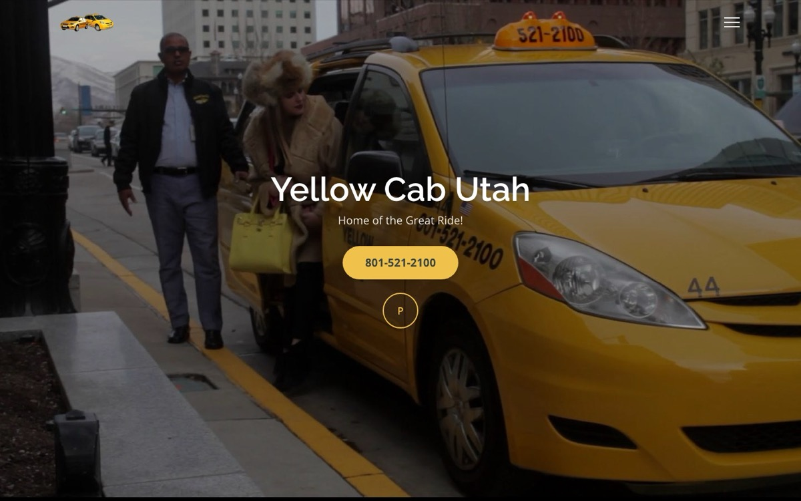
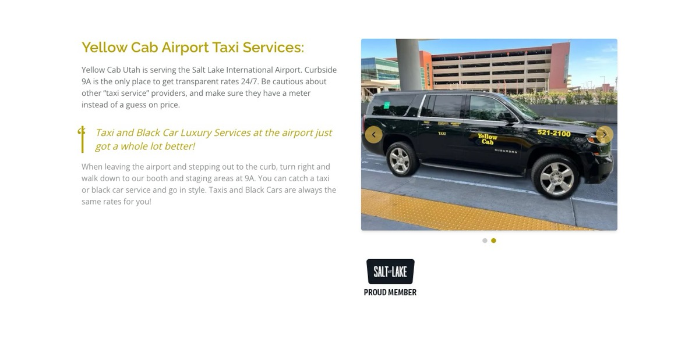
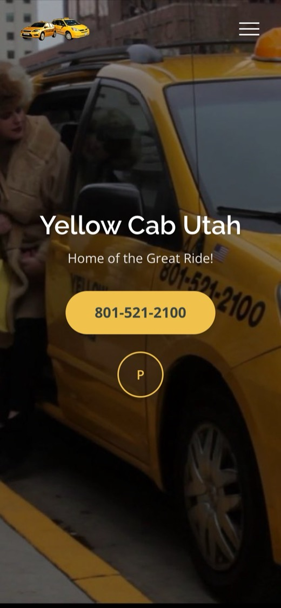
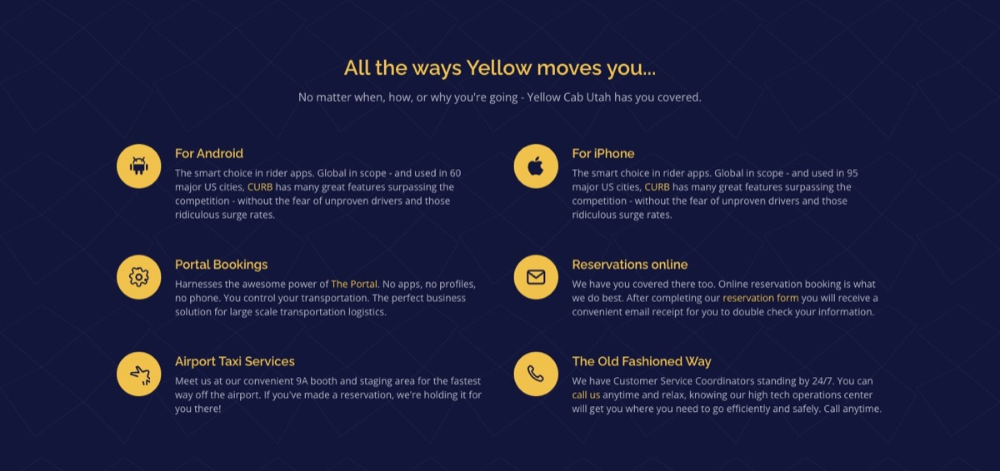
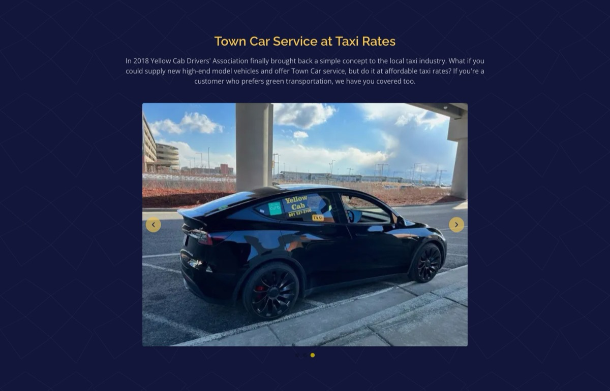

<div align="center">


# Yellow Cab Utah

**Home of the Great Ride!** 🚕

The official website for Salt Lake City's taxi and black car service.
Fast, responsive, and built on the modern Next.js stack.


<br />



</div>

---

## ✨ Highlights

- ⚡ **Fully static.** The homepage is prerendered at build time, so it loads instantly and can be hosted anywhere.
- 📱 **Mobile-first.** Every section adapts from phone to wide desktop.
- 🖼️ **Optimized images.** `next/image` serves responsive, lazy-loaded imagery; only the logo is preloaded.
- ♿ **Accessible.** Semantic HTML, alt text on every image, labelled controls, a keyboard-safe menu (Escape to close) and tap-to-call phone links.
- 🎨 **On-brand theme.** Gold and navy design tokens live in Tailwind v4 `@theme`, with Open Sans and Raleway self-hosted through `next/font`.
- ✅ **Checked in CI.** Every push runs lint, typecheck, a production build, and a smoke test.

## 📸 Screenshots

<table>
  <tr>
    <td width="72%"></td>
    <td rowspan="2" align="center"><br /><sub>Mobile</sub></td>
  </tr>
  <tr>
    <td></td>
  </tr>
  <tr>
    <td></td>
    <td></td>
  </tr>
  <tr>
    <td></td>
    <td></td>
  </tr>
</table>

## 🚀 Getting Started

Requires **Node.js 20+**.

```bash
git clone <this-repo-url>
cd <repo-folder>
npm install
npm run dev
```

Open **http://localhost:3000**. Pages hot-reload as you edit.

## 🧰 Scripts

| Command             | What it does                                              |
| ------------------- | --------------------------------------------------------- |
| `npm run dev`       | Start the dev server with Turbopack                       |
| `npm run build`     | Create an optimized production build                      |
| `npm start`         | Serve the production build                                |
| `npm run lint`      | Lint with ESLint (Next.js core-web-vitals rules)          |
| `npm run typecheck` | Generate route types and run `tsc --noEmit`               |
| `npm test`          | Smoke-test the production build (run `npm run build` first) |

### What the smoke test covers

`scripts/smoke-test.mjs` boots the real production server and checks that:

- the homepage returns `200` with its title, `lang` and meta description
- every section renders and there is exactly one `<h1>`
- every in-page `#anchor` link points to an element that exists
- every image has alt text, and every local asset actually loads
- `tel:` and `mailto:` links are well formed
- unknown routes return `404`

It has no test-framework dependencies; it uses only Node's built-in `fetch` and `assert`.

## 🗂️ Project Structure

```
src/
├── app/
│   ├── layout.tsx          # Fonts, metadata, root HTML
│   ├── page.tsx            # Assembles the homepage from sections
│   └── globals.css         # Tailwind v4 + brand tokens
├── components/
│   ├── Header.tsx          # Sticky header + full-screen menu
│   ├── Hero.tsx            # Hero with call-to-action
│   ├── Carousel.tsx        # Auto-advancing image carousel
│   ├── Footer.tsx          # Contact info + social links
│   └── sections/           # One component per homepage section
│       ├── AirportServices.tsx
│       ├── RatesTable.tsx
│       ├── ZoneCharge.tsx
│       └── …
└── lib/
    └── nav-links.ts        # Menu items
public/images/              # Site imagery
scripts/smoke-test.mjs      # Production smoke test
```

## ☁️ Deploying

The site is fully static, so it deploys with no configuration to
[Vercel](https://vercel.com/new) or any host that runs `npm run build`.

---

<div align="center">
<sub>🚕 Yellow Cab Utah · 435 S 600 W, Salt Lake City, UT 84101 · Dispatch <a href="tel:+18015212100">801-521-2100</a></sub>
</div>
